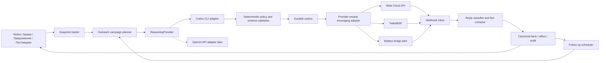

# Архитектура модуля автоматической связи с поставщиками

Дата исследования: 2026-07-20

Статус: проектное решение; реальная отправка ещё не включена

## 1. Результат решения

Для текущего проекта оптимален не самостоятельный «WhatsApp-скрипт», а провайдер-независимый модуль `supplier_outreach` внутри существующего Python-core:

- Python управляет кампаниями, очередью, политиками, Codex CLI, входящими ответами и записью результатов;
- конкретный канал подключается через заменяемый адаптер;
- для промышленной эксплуатации основным транспортом должен быть официальный WhatsApp Business Platform — напрямую через Cloud API либо через BSP, например Twilio;
- Baileys-bridge из `shermos-bot` можно адаптировать как быстрый пилот, но нельзя делать его единственным безотказным каналом;
- Chrome и Computer Use остаются инструментами диагностики и аварийного восстановления, а не транспортом массовой отправки;
- Codex только формирует и разбирает структурированные решения. Он не получает токены канала и сам не выполняет отправку.

Рекомендуемый режим запуска — `bounded_autopilot`: агент самостоятельно отправляет обычные запросы цены/наличия и ограниченные follow-up, но не заказывает, не резервирует, не принимает замену и не обещает оплату или поставку.

Критическое ограничение: опубликованный на сайте номер поставщика сам по себе не является WhatsApp opt-in. Поэтому compliant production-поток должен хранить доказательство согласия/существующего диалога; для холодного первого контакта может потребоваться другой законный канал, click-to-chat/QR либо разовое привлечение поставщика в диалог. Неофициальный Baileys технически снимает template-ограничение, но не превращает нежелательную массовую рассылку в безопасный сценарий и повышает риск блокировки номера.

## 2. Что уже есть в проекте

Начинать с нуля не требуется. В текущем `tender_agent` уже реализованы:

- SQLite-хранилище задач, фактов, snapshot, аудита, approvals, idempotency keys и side effects;
- leased jobs, bounded retry и dead-letter;
- `MessagingAdapter` и защита от повторной отправки при неопределённом результате;
- канонические snapshot и доказательный pipeline;
- Notion как операционная витрина, а не транзакционная очередь.

Текущий `ApprovedMessageDispatcher` требует точного ручного approval каждого текста. Для новой задачи его не следует удалять. Нужно добавить второй путь — `PolicyCheckedMessageDispatcher`, который разрешает автоматическую отправку только при прохождении детерминированной политики.

## 3. Что показало исследование `shermos-bot`

Полезные элементы в `/Users/mosesvasilenko/shermos-bot`:

1. `whatsapp-bridge/` отделяет нестабильную библиотеку WhatsApp от Python-бизнес-логики.
2. Сессия Baileys хранится в Redis и переживает перезапуск процесса.
3. `/send` принимает обязательный `idempotency_key`, использует `SET NX` и возвращает provider message id.
4. Входящие сообщения сначала направляются в Python ingress, а при сбое складываются в durable spool.
5. Outbox не пересылает запись, у которой уже появился `external_message_id`.
6. Ошибки делятся на временные и постоянные.
7. CLI запускается через `asyncio.create_subprocess_exec`: prompt передаётся через stdin, есть semaphore, timeout и завершение группы процессов.
8. Интерактивные WhatsApp-кнопки имеют plain-text fallback.

Что нельзя переносить как есть:

- прямую зависимость доменной модели от JID Baileys;
- предположение, что `sent` равно `delivered` или что поставщик ответил;
- Redis как единственное доказательство бизнес-состояния;
- бесконтрольные автоматические сообщения с личного номера;
- конкретные правила Shermos, относящиеся к его клиентам и замерам.

## 4. Варианты реализации

Оценка: 5 — лучше. `TCO` учитывает разработку, сопровождение и вероятность ручного восстановления.

| № | Вариант | Официальность | Скорость пилота | Надёжность | TCO | Вывод |
|---:|---|---:|---:|---:|---:|---|
| 1 | Meta WhatsApp Cloud API напрямую | 5 | 3 | 5 | 4 | Основной рекомендуемый production-путь |
| 2 | WhatsApp через BSP/Twilio | 5 | 4 | 5 | 3 | Самый простой официальный старт при приемлемой цене |
| 3 | Baileys bridge по образцу `shermos-bot` | 1 | 5 | 2 | 3 | Лучший быстрый пилот, но не единственный канал |
| 4 | `whatsapp-web.js` | 1 | 4 | 2 | 2 | Рабочая альтернатива Baileys, тяжелее из-за браузера |
| 5 | WPPConnect Server | 1 | 4 | 2 | 2 | Готовый REST-слой, но лишняя платформа и тот же риск WhatsApp Web |
| 6 | Evolution API | 2–5 | 3 | 3–5 | 2 | Полноценная платформа с Baileys и Cloud API; для MVP избыточна |
| 7 | Chrome extension / Computer Use / WhatsApp Desktop | 1 | 2 | 1 | 1 | Только аварийный ручной fallback |

### 4.1. Meta WhatsApp Cloud API

Схема: Python adapter → Graph API → provider webhooks → Python ingress.

Преимущества:

- официальный путь;
- delivery/read/error webhooks;
- нет связанной сессии телефона;
- предсказуемее эксплуатация и масштабирование;
- проще доказать, какое сообщение было принято провайдером.

Ограничения:

- требуется WABA, номер, настройка приложения и webhook;
- для business-initiated коммуникации вне клиентского 24-часового окна потребуются одобренные templates;
- необходимо явное согласие адресата на WhatsApp-коммуникацию и обработка opt-out;
- onboarding дольше пилота на личном номере.

Когда выбирать: сразу, если удаётся оформить официальный бизнес-номер и легальный сценарий первого контакта с поставщиками.

### 4.2. BSP/Twilio

Схема почти та же, но onboarding, шаблоны и API инкапсулирует провайдер.

Преимущества:

- официальный канал;
- Python SDK, webhook и диагностические коды ошибок;
- меньше собственной инфраструктуры Meta;
- удобный sandbox для контрактных тестов.

Ограничения:

- комиссия провайдера поверх тарификации Meta;
- vendor lock-in;
- правила opt-in, templates и 24-часового окна всё равно действуют.

Когда выбирать: если важнее быстрый официальный запуск и поддержка, чем минимальная стоимость сообщения.

### 4.3. Baileys bridge

Схема: Python core → локальный HTTP bridge на TypeScript → Baileys → linked WhatsApp device.

Преимущества:

- уже есть близкая реализация в `shermos-bot`;
- свободный текст без template onboarding;
- быстрый пилот на отдельном номере;
- двусторонние сообщения и media.

Риски:

- неофициальный интерфейс;
- возможны бан, logout, повторная привязка и breaking changes;
- Baileys v7 требует аккуратной миграции;
- `sent` не гарантирует доставку;
- недопустимо использовать основной личный номер без изолированного пилота.

Когда выбирать: пилот на отдельном номере, ограниченном allowlist поставщиков и малой скорости отправки.

### 4.4. whatsapp-web.js

Использует управляемый браузер/Puppeteer и WhatsApp Web.

Плюсы: большое сообщество, понятная browser-модель, локальная сессия.

Минусы: высокий расход памяти, DOM/browser fragility, неофициальность и риск блокировки. Для нашего pipeline хуже Baileys, поскольку уже есть Node-sidecar без необходимости поднимать Chromium на каждую сессию.

### 4.5. WPPConnect Server

Даёт готовый REST API поверх WhatsApp Web, multi-session и webhook.

Плюсы: меньше собственного TypeScript-кода.

Минусы: ещё один крупный сервис, собственная модель данных, сложнее встроить нашу строгую идемпотентность и audit; риски неофициального канала никуда не исчезают.

### 4.6. Evolution API

Готовая интеграционная платформа, способная работать и с Baileys, и с официальным Cloud API.

Плюсы: единая API-поверхность, несколько каналов и интеграций.

Минусы: Redis/Postgres/операционная сложность и значительная лишняя функциональность. Имеет смысл, если продукт станет многопользовательской SaaS-платформой с несколькими номерами; для одного оператора это преждевременно.

### 4.7. Chrome / Computer Use

Проверка показала, что локальное WhatsApp-приложение доступно через accessibility лишь частично: поле сообщения видно, но поиск и создание нового чата не имеют стабильных контролов. В Chrome состояние зависит от вкладки, логина, DOM и уведомлений.

Допустимое применение:

- показать оператору проблемный чат;
- диагностировать logout/QR;
- разово восстановить номер;
- сравнить визуальное состояние с provider log.

Недопустимое применение:

- фоновая массовая отправка;
- определение истины о доставке;
- повтор после таймаута без provider id;
- хранение очереди в состоянии интерфейса.

## 5. Решение по языку

### Почему не C/C++ как основной язык

C++ способен запустить `codex` через `fork/exec`, обращаться по HTTP и работать с SQLite, но не даёт преимущества в этом I/O-bound модуле. Зато появятся:

- ручное управление subprocess, timeout, signal и JSON schema;
- более дорогие async HTTP/webhook и migration-тесты;
- отдельные binding/sidecar для большинства WhatsApp-решений, которые всё равно написаны на TypeScript;
- две технологические экосистемы рядом с уже существующим Python-core.

### Рекомендуемый стек

- Python 3.12+: orchestration, policies, outbox/inbox, Codex runner, Notion projection;
- SQLite в локальном v1, с переносимой схемой на Postgres;
- FastAPI только для webhook/API процесса, когда появится реальный провайдер;
- TypeScript sidecar только для Baileys-пилота;
- `httpx` или стандартный HTTP-клиент в provider adapters;
- Pydantic/JSON Schema для контрактов LLM и webhook.

C++ можно оставить для будущих тяжёлых локальных extractor/vision-компонентов, если profiling покажет реальную необходимость.

## 6. Целевая архитектура



Это модульный монолит. Отдельным процессом является только transport bridge, если выбран Baileys. Преждевременное разбиение Python-части на микросервисы не требуется.

## 7. Границы модулей

Предлагаемая структура:

```text
src/tender_agent/outreach/
  contracts.py          # неизменяемые команды/события и JSON schemas
  campaigns.py          # какие позиции и поставщики контактируются
  planner.py            # порядок контактов, batching, дедупликация
  policy.py             # детерминированные разрешения и запреты
  codex_provider.py     # безопасный subprocess adapter
  drafting.py           # initial RFQ/follow-up/clarification
  reply_parser.py       # структурированный разбор ответов
  dispatcher.py         # outbox -> provider
  followups.py          # расписание и лимиты повторов
  service.py            # application use cases
  adapters/
    base.py
    dry_run.py
    meta_cloud.py
    twilio.py
    baileys.py
services/whatsapp-bridge/   # только если утверждён Baileys-пилот
```

Ключевые интерфейсы:

```python
class ReasoningProvider(Protocol):
    async def decide(self, task: ReasoningTask) -> OutreachDecision: ...

class MessagingProvider(Protocol):
    async def send(self, command: SendCommand) -> ProviderReceipt: ...
    def verify_webhook(self, headers: Mapping[str, str], body: bytes) -> None: ...
    def parse_webhook(self, body: bytes) -> tuple[ProviderEvent, ...]: ...
```

`OutreachDecision` не содержит команды произвольного исполнения. Только фиксированные значения: тип сообщения, текст, список вопросов, извлечённые коммерческие факты, confidence и рекомендуемое следующее действие.

## 8. Модель данных и миграция

Нужна совместимая схема v2. Старые таблицы и `ApprovedMessageDispatcher` сохраняются.

Новые таблицы:

- `outreach_campaigns`: заявка, набор позиций, режим, статус, лимиты;
- `outreach_threads`: provider account + supplier contact + request/line context;
- `outbound_messages`: immutable body, template version, policy result, status;
- `inbound_messages`: provider id, sender, raw hash, normalized content;
- `delivery_attempts`: attempt, provider response, error class, timestamps;
- `supplier_contact_policies`: consent source, quiet hours, DNC, language, limits;
- `llm_runs`: prompt/input hash, model/provider, schema version, result hash, timing;
- `provider_accounts`: logical account id и metadata без секретов;
- `message_attachments`: content hash, local artifact id, provider media id.

Связь с Notion:

- SQLite/Postgres — каноническое состояние исполнения и сообщений;
- Notion — проекция итогов: `Связались`, `Последний ответ`, `Цена подтверждена`, `Наличие подтверждено`, `Доставка`, `Следующее действие`, `Дата актуальности`;
- в Notion не хранить access tokens, auth state и raw webhooks;
- ответ поставщика создаёт новый факт/наблюдение, а не перезаписывает исходный техспек.

Миграция должна быть additive: сначала создаются новые таблицы и dual-read, затем включается новый dispatcher. Breaking change не требуется.

## 9. Машина состояний

```text
planned
  -> drafted
  -> policy_checked
  -> queued
  -> sending
  -> sent
  -> delivered | read | failed | uncertain
  -> replied
  -> parsed
  -> followup_due | resolved | escalated
  -> closed
```

Правила:

- `sent`, `delivered`, `read` и `replied` — разные факты;
- после сетевого timeout отправка переходит в `uncertain`, если нет доказательства provider id;
- `uncertain` нельзя автоматически переслать тем же или другим каналом до reconciliation;
- входящий provider event дедуплицируется по `(provider_account_id, provider_event_id)`;
- статус Notion меняется только после commit канонического факта.

## 10. Интеграция Codex CLI

На проверенной машине установлено:

```text
/opt/homebrew/bin/codex
codex-cli 0.142.5
```

Отдельной команды `chatgpt` нет. Ребрендинг desktop-приложения не изменил имя локального CLI. Для автоматического one-shot режима используется `codex exec`, а не интерактивный `codex`.

Базовый запуск:

```bash
codex exec \
  --ephemeral \
  --ignore-user-config \
  --ignore-rules \
  --sandbox read-only \
  --skip-git-repo-check \
  -C /path/to/isolated/context \
  --output-schema /path/to/outreach-decision.schema.json \
  --output-last-message /tmp/outreach-decision.json \
  -
```

Prompt передаётся через stdin. Процесс получает:

- frozen JSON snapshot только нужной позиции и поставщика;
- подтверждённые факты источника;
- отсутствующие вопросы;
- язык и тон;
- запреты на обещания, раскрытие тендерного лимита и придумывание характеристик.

Защита subprocess:

- allowlist флагов, без shell interpolation;
- отдельный временный read-only context;
- `--ephemeral`, чтобы не копить пользовательские сессии;
- concurrency 1–2;
- timeout 90–120 секунд;
- отдельная process group: `SIGTERM`, затем `SIGKILL`;
- ограниченный environment без WhatsApp/Notion secrets;
- размер stdout/stderr ограничивается;
- prompt и результат хешируются для аудита, чувствительные данные редактируются в логах.

Важное ограничение текущего CLI: `--output-schema` и JSONL events нельзя считать достаточной гарантией корректного финального JSON, особенно при tool/MCP событиях. Поэтому модуль читает только файл `--output-last-message`, валидирует его независимо, и максимум один раз выполняет repair-проход. После второй ошибки задача уходит в `escalated`, а не в отправку.

Долгосрочно `ReasoningProvider` позволяет заменить CLI на OpenAI Responses API без изменения messaging workflow. API предпочтительнее для постоянного серверного процесса; CLI полезен как локальный первый адаптер и соответствует текущему способу работы пользователя.

## 11. Автономная политика

Режимы:

| Режим | Поведение |
|---|---|
| `observe` | Создать черновики, ничего не отправлять |
| `approved` | Использовать текущий exact-payload approval |
| `bounded_autopilot` | Автоматически отправлять только разрешённые RFQ/follow-up |
| `full_autopilot` | Не внедрять: коммерческие обязательства слишком рискованны |

`bounded_autopilot` разрешает:

- запросить актуальные цену, остаток, MOQ, фото, документы, адрес, доставку и срок;
- уточнить ровно те параметры, которых нет в доказательствах;
- один первичный контакт и максимум два follow-up;
- классифицировать ответ и обновить предложение;
- прекратить цепочку после ответа, opt-out или достижения лимита.

Всегда запрещено без отдельного authority/approval:

- оформить заказ или резерв;
- согласиться на цену или замену;
- обещать оплату, дату поставки или объём будущей закупки;
- отправлять платёжные данные, документы с персональными данными или секреты;
- раскрывать тендерную цену/лимит;
- писать поставщику, у которого нет законного основания/opt-in для выбранного официального канала;
- продолжать после просьбы не писать.

Дополнительные ограничения:

- quiet hours по часовому поясу контакта;
- глобальный, per-account и per-supplier rate limit с jitter;
- дневной kill switch и максимальное число новых контактов;
- отдельный тестовый номер;
- запрет дублировать один запрос разным сотрудникам одной компании без причины;
- локальный язык сообщения выбирается из доказанной истории, по умолчанию русский;
- минимизация персональных данных и срок хранения raw messages.

## 12. Идемпотентность и повторная доставка

Стабильный ключ сообщения:

```text
sha256(
  provider_account_id |
  supplier_contact_id |
  request_id |
  line_id |
  semantic_intent |
  template_version |
  followup_sequence |
  normalized_payload_hash
)
```

Outbox сначала фиксирует immutable message, затем отправляет. Provider receipt сохраняется в той же бизнес-транзакции, насколько позволяет адаптер. Нельзя считать HTTP retry безопасным только потому, что у запроса тот же body: провайдер обязан либо поддерживать идемпотентность, либо адаптер должен провести reconciliation по provider log/webhook.

## 13. Полный рабочий поток

1. Оператор в Notion отмечает позиции/предложения, для которых требуется контакт, либо создаётся автоматическая кампания по всем незакрытым позициям.
2. Planner дедуплицирует поставщиков и группирует совместимые позиции в одно короткое сообщение.
3. Из snapshot собираются только подтверждённые параметры и неизвестные вопросы.
4. Codex возвращает структурированный `OutreachDecision`.
5. Детерминированный validator проверяет номер, длину, запрещённые утверждения, цены, политику контакта и лимиты.
6. Outbox создаёт сообщение и уникальный idempotency key.
7. Dispatcher вызывает provider adapter.
8. Webhook фиксирует delivery/read/reply независимо от исходящего worker.
9. Reply parser извлекает цену, НДС, единицу, MOQ, доступное количество, город, доставку, срок, документы и отклонения от ТЗ.
10. Каждое утверждение получает source=`supplier_message`, timestamp и ссылку на message artifact.
11. Notion projection обновляет соответствующее `Предложение` и карточку поставщика, не меняя исходную `Заявку`.
12. Scheduler закрывает ветку, создаёт уточняющий вопрос либо планирует следующий ограниченный follow-up.

## 14. Наблюдаемость и эксплуатация

Минимальные метрики:

- queue depth и oldest queued age;
- сообщения `queued/sent/delivered/read/replied/failed/uncertain`;
- time-to-first-reply и time-to-quote;
- доля ответов с полной ценой/наличием/доставкой;
- provider disconnect/logout и webhook lag;
- LLM timeout/schema/repair rate;
- policy denial и DNC count;
- дубли, предотвращённые idempotency;
- стоимость провайдера и LLM на подтверждённое предложение.

Нужны health endpoints для store, worker, Codex CLI, provider, webhook и Notion projection. Логи содержат correlation id, campaign id, request id, line id, supplier id и message id, но не полный текст/телефон по умолчанию.

Локальный v1 можно запускать через `launchd`; серверную версию — через systemd/Docker. Redis и Postgres не требуются до реального multi-process/multi-operator режима: текущего SQLite с WAL и одним writer достаточно для пилота.

## 15. Тестовая стратегия

### Unit

- JSON schema и запрещённые поля;
- policy matrix для всех режимов;
- quiet hours, rate limit, DNC и dedupe;
- idempotency key;
- reply extraction на неоднозначных ценах/единицах;
- subprocess timeout, non-zero exit, oversized output и malformed JSON.

### Contract

- единый набор тестов для `dry_run`, Meta, Twilio и Baileys adapters;
- webhook signature/secret verification;
- provider error → transient/permanent/uncertain mapping;
- compatibility tests с сохранёнными provider fixtures.

### Integration

- crash до send;
- crash после фактического send, но до записи receipt;
- duplicate webhook;
- late reply после закрытия кампании;
- поставщик отвечает по нескольким позициям одним сообщением;
- Notion временно недоступен после принятого ответа;
- logout Baileys и повторное подключение.

### End-to-end

1. `dry_run` без сети — обязателен первым.
2. Официальный sandbox или отдельный Baileys-номер пишет только тестовым контактам.
3. Полученный ответ создаёт факт и обновляет тестовую Notion-строку.
4. Повтор того же webhook и перезапуск worker не создают дублей.
5. Ни один тест не использует production-поставщика или основной номер.

Независимость тестов: новая временная БД на тест, fake clock, fake provider, отдельные fixtures и отсутствие зависимости от порядка запуска.

## 16. Этапы реализации

### Этап A — contracts и dry-run

- additive SQLite migration v2;
- модели campaign/thread/message/event;
- `ReasoningProvider` и безопасный `CodexExecProvider`;
- policy engine;
- `DryRunMessagingProvider`;
- CLI-команды plan/draft/dispatch-dry-run;
- unit/golden tests.

Критерий: для выбранных Notion-предложений создаются валидные, дедуплицированные сообщения, но сеть не вызывается.

### Этап B — один реальный адаптер

Предпочтение:

1. Meta Cloud API;
2. Twilio, если onboarding Meta тормозит;
3. Baileys на отдельном номере как временный пилот.

- outbox/inbox;
- webhook/bridge ingress;
- provider receipts;
- kill switch и limits;
- тестовая кампания на allowlist.

Критерий: отправка и ответ восстанавливаются после рестарта без дубля.

### Этап C — ответы и Notion

- reply parser;
- коммерческие fact assertions;
- обновление `Предложения`, `Поставщики` и даты актуальности;
- follow-up scheduler;
- operator summary.

Критерий: подтверждённая цена и наличие видны в существующей рабочей витрине без ручного copy-paste.

### Этап D — bounded autopilot

- автоматические обычные RFQ и два follow-up;
- compliance/opt-out;
- метрики качества и стоимости;
- canary rollout 5 → 20 → 50 контактов;
- официальный transport cutover, если пилот был на Baileys.

Критерий: не менее 95% цепочек не требуют ручной обработки до коммерческого решения, при нуле автоматических заказов/резервов/обязательств и отсутствии дублей.

## 17. Решения до начала runtime-реализации

Единственный выбор, который материально меняет Этап B: какой номер/провайдер допустимо использовать.

Для Этапа A решение не требуется — он полностью provider-neutral и выполняется в dry-run. После него нужно выбрать:

- официальный Meta Cloud API;
- Twilio/BSP;
- отдельный тестовый номер Baileys с принятым риском.

## 18. GitHub и документация

- [OpenAI Codex CLI: non-interactive exec](https://github.com/openai/codex/blob/main/docs/exec.md)
- [OpenAI Codex CLI source](https://github.com/openai/codex/blob/main/codex-rs/exec/src/cli.rs)
- [Meta WhatsApp Cloud API examples](https://github.com/fbsamples/whatsapp-api-examples)
- [Twilio Python SDK](https://github.com/twilio/twilio-python)
- [Baileys](https://github.com/WhiskeySockets/Baileys)
- [whatsapp-web.js](https://github.com/wwebjs/whatsapp-web.js)
- [WPPConnect](https://github.com/wppconnect-team/wppconnect)
- [WPPConnect Server](https://github.com/wppconnect-team/wppconnect-server)
- [Evolution API](https://github.com/evolution-foundation/evolution-api)
- [Twilio: WhatsApp quickstart and 24-hour window](https://www.twilio.com/docs/whatsapp/quickstart)
- [Twilio: template messages](https://www.twilio.com/docs/whatsapp/tutorial/send-whatsapp-notification-messages-templates)

## 19. Итоговая рекомендация

1. Реализовать Этап A на Python поверх существующего `tender_agent`; не создавать отдельный большой бот.
2. Сохранить текущий approval dispatcher и добавить детерминированный bounded-autopilot рядом с ним.
3. Использовать `codex exec` как первый `ReasoningProvider`, но не давать ему выполнять отправку.
4. Основным production-транспортом выбрать Meta Cloud API или Twilio.
5. Если нужен результат раньше официального onboarding — адаптировать Shermos Baileys bridge на отдельном номере, с низкими лимитами и планом миграции.
6. Не использовать Chrome/Computer Use как очередь или автономный sender.
7. Начать с dry-run и независимых crash/idempotency тестов; только затем разрешать реальные адреса.
